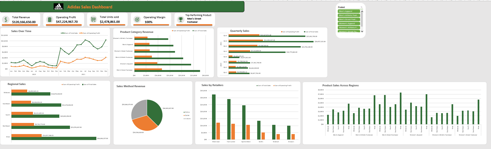

# adidas-sales-analysis
An Excel-based analysis of Adidas sales, profitability, product performance, retailers, regions, and sales channels.
# Adidas Sales Analysis | Excel Data Analytics Project

## Project Overview

This project analyzes Adidas retail sales data using Microsoft Excel to evaluate sales performance, profitability, product demand, retailer performance, regional sales, and sales channel effectiveness.

The project demonstrates my ability to transform sales data into meaningful insights that can support business decision-making.

## Objectives

- Evaluate overall sales and operating profit.
- Identify top-performing products and retailers.
- Compare sales performance across regions.
- Analyze sales channels, including online, in-store, and outlet.
- Examine monthly and quarterly sales trends.
- Develop data-driven business recommendations.

## Tools Used

- Microsoft Excel
- Data Cleaning and Preparation
- PivotTables and PivotCharts
- KPI Analysis
- Excel Dashboard Design
- Trend Analysis

## Key Performance Indicators

- Total Sales
- Total Operating Profit
- Operating Margin
- Units Sold
- Average Order Value (AOV)

## Key Insights

- Men's Street Footwear was a leading product category in sales and operating profit.
- Women's Apparel was another strong contributor to overall sales.
- Women's Athletic Footwear recorded comparatively lower sales among the six product categories.
- Sales performance can be evaluated across retailers, regions, and sales channels to identify opportunities for improvement.

## Business Recommendations

- Prioritize high-performing products while reviewing demand for lower-performing categories.
- Optimize sales channels based on revenue, operating profit, and units sold.
- Focus marketing and distribution efforts on regions with strong growth opportunities.
- Use historical sales trends to support inventory planning and demand forecasting.
- Strengthen retailer partnerships using performance-based insights.

## Project Deliverables

- Excel analysis workbook
- Interactive sales dashboard
- Business insights and recommendations

## Conclusion

This project strengthened my practical skills in Excel-based data analysis, KPI reporting, data visualization, and business intelligence.

**Project Category:** Retail Sales Analysis
**Created by:** Bright Ohiomoba

## Dashboard Preview

